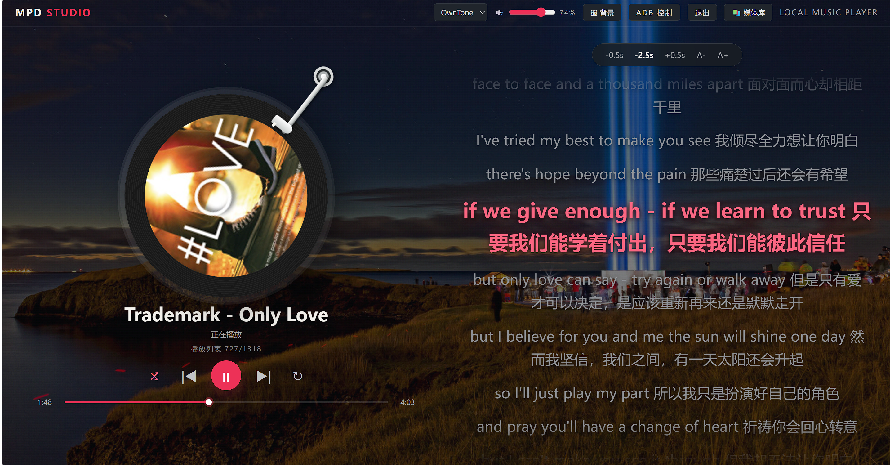

# MPD Studio — 私人音乐播放器 & ADB 控制台

一个运行在 **iStoreOS / OpenWrt** 上的轻量级 Web 音乐播放器，已经在**斐讯 N1**（ARM Cortex-A53）上验证可行。基于 **MPD**（Music Player Daemon）和Owntone，提供唱片风格界面、LRC 歌词显示、歌单管理、USB 声卡配置、HTTP 音频流，以及内置的 **ADB 控制台**用于远程操控 Android 电视和安卓智能音箱。



---

## 功能概览

- **唱片风格播放界面** — 旋转黑胶唱片动画、专辑封面、播放进度条
- **LRC 歌词** — 自动加载同名 `.lrc` 歌词，支持时间微调和字号缩放
- **MPD / OwnTone 双服务切换** — 顶部可切换音乐后台
- **HTTP 音频流** — 通过 MPD 的 `httpd` 输出在浏览器中直接收听，支持自动重连
- **USB 声卡自动配置** — 检测 USB 音频设备并一键写入 `/etc/mpd.conf`，重启 MPD 生效
- **歌单管理** — 保存队列、导入 M3U 歌单、添加/删除单曲
- **媒体库浏览** — 搜索、排序（文件名/大小/时间）、整库入队
- **登录认证** — 通过环境变量配置用户名密码，保护控制台不被未授权访问
- **背景图自定义** — 上传本地图片作为页面背景
- **ADB 控制台** — 连接 Android 电视、截图预览、安装 APK、发送遥控按键、启动应用、自定义 ADB 指令
- **视频播放器** — 浏览和播放视频文件，支持浏览器原生格式直播，非原生格式通过 FFmpeg 实时转码为 MP4 流

---

## 环境要求

| 软件 | 版本 / 说明 |
|------|------------|
| **iStoreOS / OpenWrt** | ARM 架构，已在**斐讯 N1**上验证 |
| **Python 3** | 3.8+ 推荐 |
| **Flask** | `pip install flask`（Python Web 框架） |
| **mpc** | MPD 命令行客户端（`apk add mpc`） |
| **MPD** | Music Player Daemon，需编译 `httpd` 和 `lame` 支持 |
| **ALSA** | 音频驱动框架（`alsa-lib`、`alsa-utils`） |
| **FFmpeg**（可选） | 视频转码引擎，非 MP4/WebM 格式需 FFmpeg 实时转码 |
| **adb**（可选） | Android Debug Bridge，用于 ADB 控制台功能 |

---

## 文件说明

| 文件 | 用途 |
|------|------|
| `mpd_web.py` | Flask 主程序，包含全部后端 API 和前端界面 |
| `login.html` | 登录页面模板（与主程序放在同一目录） |
| `adb.html` | ADB 控制台页面模板（与主程序放在同一目录） |
| `video.html` | 视频播放器页面模板（与主程序放在同一目录） |
| `mpd.conf` | MPD 配置文件示例（部署到 `/etc/mpd.conf`） |
| `mpd-web_env.txt` | 环境变量配置示例 |

---

## 安装与部署

### 1. 安装系统依赖

在 iStoreOS SSH 终端中执行：

```sh
# 更新软件源
apk update

# 安装 ALSA 音频驱动（USB 声卡依赖）
apk add alsa-lib alsa-utils

# 安装 MPD 及客户端工具
apk add mpd mpc

# 安装 ADB（可选）
apk add adb

# 安装 FFmpeg（可选，视频转码需要）
apk add ffmpeg

# 安装 Python 和 Flask
apk add python3 py3-pip
pip install flask
```

### 2. 验证 MPD 功能

确认 MPD 已编译 `httpd` 和 `lame` 支持：

```sh
mpd --version
```

输出中应包含 `httpd` 输出插件和 `lame` 编码器。如果缺少，需安装对应的 MPD 插件包。

### 3. 安装 OwnTone（可选，Docker 方式）

OwnTone（原名 forked-daapd）是另一款音乐服务器，支持 AirPlay 和 MPD 协议，可通过 Docker 与 MPD 共存。

```sh
# 拉取并运行 OwnTone Docker 容器
docker run -d \
  --name owntone \
  --net=host \
  -v /你的音乐目录:/music:ro \
  -v /etc/owntone.conf:/etc/owntone.conf \
  -v /var/cache/owntone:/var/cache/owntone \
  --restart unless-stopped \
  jc21/owntone:latest
```

> 使用 `--net=host` 让容器直接使用宿主机网络，以便 MPD Web 通过 `127.0.0.1` 访问 OwnTone 的 MPD 兼容端口和 API 端口。

**`/etc/owntone.conf` 关键配置项**（在宿主机上创建该文件后挂载进容器）：

```conf
general {
    uid = "owntone"
}
library {
    directories = { "/music" }
}
mpd {
    port = 6600                            # MPD 兼容端口，不能与 MPD 的 6601 冲突
}
# WebSocket 端口默认 3688，JSON API 默认 3689
allow_modifying_stored_playlists = true     # 必须开启，否则网页端无法保存歌单
```

确保 OwnTone 与 MPD 使用**相同的歌单目录**（映射到容器内同一路径），这样两种服务模式下的歌单才能互通。

```sh
docker restart owntone
```

> **提示**：如果不需要 OwnTone，跳过此步骤。网页顶部仍可选择 MPD 模式正常工作。

### 4. 部署 MPD 配置

将仓库中的 `mpd.conf` 复制到 `/etc/mpd.conf`，根据实际环境修改以下路径：

- `music_directory` — 音乐文件存放目录
- `playlist_directory` — 歌单存放目录
- `audio_output` 中的 `device` — USB 声卡设备号

```sh
cp mpd.conf /etc/mpd.conf
/etc/init.d/mpd restart
```

### 5. 部署 Web 程序

将以下文件复制到 iStoreOS 的同一目录（如 `/root/mpd/`）：

```sh
mkdir -p /root/mpd
# 将 mpd_web.py、login.html、adb.html、video.html 上传到 /root/mpd/
```

### 6. 配置登录凭据

生成随机 session 密钥：

```sh
python3 -c 'import secrets; print(secrets.token_hex(32))'
```

创建环境变量文件 `/etc/mpd-web.env`：

```sh
umask 077
cat > /etc/mpd-web.env <<'EOF'
MPD_WEB_USERNAME='admin'
MPD_WEB_PASSWORD='你的密码'
MPD_WEB_SECRET_KEY='上面生成的随机密钥'
MPD_HOST='127.0.0.1'
MPD_PORT='6601'
OWNTONE_HOST='127.0.0.1'
OWNTONE_PORT='6600'
OWNTONE_API_PORT='3689'
EOF
chmod 600 /etc/mpd-web.env
```

### 6. 创建启动服务脚本

创建 `/etc/init.d/mpd-web`：

```sh
#!/bin/sh /etc/rc.common

START=95
STOP=10
USE_PROCD=1

APP="/root/mpd/mpd_web.py"
PYTHON="/usr/bin/python3"

start_service() {
    [ -r /etc/mpd-web.env ] || return 1
    . /etc/mpd-web.env

    procd_open_instance
    procd_set_param command "$PYTHON" "$APP"
    procd_set_param env \
        "MPD_WEB_USERNAME=$MPD_WEB_USERNAME" \
        "MPD_WEB_PASSWORD=$MPD_WEB_PASSWORD" \
        "MPD_WEB_SECRET_KEY=$MPD_WEB_SECRET_KEY" \
        "MPD_HOST=$MPD_HOST" \
        "MPD_PORT=$MPD_PORT" \
        "OWNTONE_HOST=$OWNTONE_HOST" \
        "OWNTONE_PORT=$OWNTONE_PORT" \
        "OWNTONE_API_PORT=$OWNTONE_API_PORT"
    procd_set_param stdout 1
    procd_set_param stderr 1
    procd_close_instance
}
```

赋予执行权限并启动：

```sh
chmod +x /etc/init.d/mpd-web
/etc/init.d/mpd-web enable
/etc/init.d/mpd-web start
```

### 8. 访问

在浏览器中打开：

```
http://iStoreOS地址:8800/
```

ADB 控制台：

```
http://iStoreOS地址:8800/adb
```

---

## 环境变量说明

| 变量名 | 必填 | 默认值 | 说明 |
|--------|------|--------|------|
| `MPD_WEB_USERNAME` | 是 | — | 登录账号 |
| `MPD_WEB_PASSWORD` | 是 | — | 登录密码 |
| `MPD_WEB_SECRET_KEY` | 是 | — | Flask session 加密密钥（需固定，不要每次重启更换） |
| `MPD_HOST` | 否 | `127.0.0.1` | MPD 服务地址 |
| `MPD_PORT` | 否 | `6601` | MPD 服务端口 |
| `OWNTONE_HOST` | 否 | `127.0.0.1` | OwnTone 服务地址 |
| `OWNTONE_PORT` | 否 | `6600` | OwnTone MPD 兼容端口 |
| `OWNTONE_API_PORT` | 否 | `3689` | OwnTone JSON API 端口 |
| `VIDEO_DIR` | 否 | `/mnt/usb1_2-1/Video` | 视频文件存放目录 |

---

## 播放器 API 接口

所有 API 均需登录后才能访问。

| 路由 | 方法 | 用途 |
|------|------|------|
| `/api/status` | GET | 获取播放状态（歌曲、进度、音量、循环/随机） |
| `/api/cover?uri=` | GET | 获取当前歌曲专辑封面 |
| `/api/lyrics?uri=` | GET | 获取当前歌曲 LRC 歌词 |
| `/api/library` | GET | 获取完整音乐文件列表（含大小、时间） |
| `/api/control/<cmd>` | GET | 播放控制：play / pause / toggle / stop / next / prev / repeat / random |
| `/api/volume/<0-100>` | GET | 设置音量 |
| `/api/seek` | POST | 跳转到指定进度（`{"percent": 50}`） |
| `/api/play` | POST | 播放指定 URI 的歌曲 |
| `/api/queue/play` | POST | 播放队列中指定位置的歌曲 |
| `/api/add` | POST | 添加歌曲到队列 |
| `/api/add-all` | GET | 整库入队 |
| `/api/clear` | GET | 清空播放队列 |
| `/api/playlists` | GET | 获取歌单列表 |
| `/api/playlists/save` | POST | 保存当前队列为歌单 |
| `/api/playlists/import` | POST | 导入 M3U 歌单文件 |
| `/api/playlists/load` | POST | 载入并播放歌单 |
| `/api/playlists/delete` | POST | 删除歌单 |
| `/api/playlists/<name>/tracks` | GET | 获取歌单歌曲列表 |
| `/api/playlists/addtrack` | POST | 添加歌曲到歌单 |
| `/api/playlists/removetrack` | POST | 从歌单移除歌曲 |
| `/api/playlists/playtrack` | POST | 播放歌单中指定歌曲 |
| `/api/service` | GET/POST | 切换/获取音乐服务（MPD / OwnTone） |
| `/api/audio` | GET | 获取 USB 设备列表和 MPD 输出状态 |
| `/api/audio/select` | POST | 切换 MPD 输出开关 |
| `/api/audio/configure` | POST | 自动检测并配置 USB 声卡到 `/etc/mpd.conf` |
| `/api/background` | GET | 获取自定义背景图 |
| `/api/background` | POST | 上传背景图（最大 8MB） |
| `/api/background` | DELETE | 删除背景图 |
| `/logout` | POST | 退出登录 |

### 视频 API

| 路由 | 方法 | 用途 |
|------|------|------|
| `/video` | GET | 视频播放器页面 |
| `/api/video/list?path=<路径>` | GET | 获取视频目录文件列表 |
| `/api/video/play?path=<路径>` | GET | 播放视频（MP4/WebM/M4V 直出，其他格式 FFmpeg 转码） |
| `/api/video/download?path=<路径>` | GET | 下载视频文件 |

---

## ADB 控制台

ADB 控制台页面 (`/adb`) 支持以下功能：

- **连接/断开设备** — 输入电视 IP 和端口
- **应用管理** — 列出第三方/全部应用包名、启动应用
- **发送遥控按键** — 方向键、确认、返回、主页、音量等
- **打开网址** — 在电视浏览器中打开 URL
- **截图预览** — 实时获取电视截图（约 1.2 秒刷新）
- **上传安装 APK** — 从浏览器上传 APK 安装到电视（最大 256MB）
- **自定义 ADB 指令** — 支持 shell、install、uninstall、push、pull、logcat、reboot 子命令
- **指令历史** — 保存并导出 ADB 操作记录

### ADB API

| 路由 | 方法 | 用途 |
|------|------|------|
| `/api/adb/devices` | GET | 列出已连接设备 |
| `/api/adb/connect` | POST | 连接设备 |
| `/api/adb/disconnect` | POST | 断开设备 |
| `/api/adb/apps` | POST | 列出设备应用 |
| `/api/adb/open-url` | POST | 在设备上打开网址 |
| `/api/adb/launch-app` | POST | 启动设备应用 |
| `/api/adb/key` | POST | 发送遥控按键 |
| `/api/adb/install-apk` | POST | 上传并安装 APK |
| `/api/adb/command` | POST | 自定义 ADB 指令 |
| `/api/adb/screenshot` | GET | 获取设备截图 |

---

## HTTP 音频流配置

MPD 的 HTTP 音频流通过 `mpd.conf` 中的 `httpd` 输出配置：

```
audio_output {
    type            "httpd"
    name            "MPD HTTP Stream"
    encoder         "lame"
    port            "8000"
    bind_to_address "0.0.0.0"
    bitrate         "192"
    format          "44100:16:2"
    max_clients     "4"
    enabled         "yes"
}
```

流地址：`http://iStoreOS地址:8000/`

网页播放器会自动连接此流并在浏览器中播放。HTTP 流默认对歌词和进度有约 6 秒缓冲补偿，可通过歌词栏的 ±0.5s 按钮微调。

---

## 视频播放器

视频播放器页面 (`/video`) 提供类似文件管理器的视频浏览和播放功能：

- **目录浏览** — 左侧视频列表支持目录导航，显示文件名、大小、修改时间
- **浏览器原生播放** — MP4、WebM、M4V 格式直接输出给浏览器，无需转码
- **FFmpeg 实时转码** — 其他格式（MKV、AVI、MOV、FLV、WMV、TS、MTS）通过 FFmpeg 实时转码为 MP4 流
- **全屏播放** — 支持全屏模式和自定义控件（播放/暂停、进度条、音量）
- **视频下载** — 点击下载按钮直接下载原始文件

### FFmpeg 转码说明

对于浏览器不原生支持的视频格式，后端调用 FFmpeg 实时转码：

```sh
ffmpeg -i <输入文件> \
  -c:v libx264 -preset ultrafast -tune zerolatency \
  -c:a aac -b:a 128k \
  -movflags frag_keyframe+empty_moov \
  -f mp4 pipe:1
```

- 使用 `ultrafast` 预设和 `zerolatency` 调优，优先保证低延迟
- 音频编码为 AAC 128kbps
- 输出为流式 MP4（fragmented MP4），适合边转边播

### 视频目录配置

通过环境变量 `VIDEO_DIR` 指定视频文件存放目录，默认值为 `/mnt/usb1_2-1/Video`。程序仅允许访问该目录及其子目录下的文件，确保安全性。

支持的视频格式：

| 格式 | 播放方式 |
|------|---------|
| `.mp4` | 浏览器原生播放 |
| `.webm` | 浏览器原生播放 |
| `.m4v` | 浏览器原生播放 |
| `.mkv` | FFmpeg 转码为 MP4 |
| `.avi` | FFmpeg 转码为 MP4 |
| `.mov` | FFmpeg 转码为 MP4 |
| `.flv` | FFmpeg 转码为 MP4 |
| `.wmv` | FFmpeg 转码为 MP4 |
| `.ts` | FFmpeg 转码为 MP4 |
| `.mts` | FFmpeg 转码为 MP4 |

---

## MPD 与 OwnTone 歌单的区别

网页顶部可切换 MPD 或 OwnTone 模式，两种模式下的歌单**底层共享同一目录**，但操作机制不同：

| 操作 | MPD 模式 | OwnTone 模式 |
|------|---------|-------------|
| **查看歌单列表** | `mpc lsplaylists` 直接读取 `.m3u` 文件 | 通过 OwnTone JSON API `GET /api/library/playlists` 获取 |
| **保存当前队列** | `mpc save <名称>` 写入 `.m3u` 文件 | 同样调用 `mpc save`（MPD 协议），需 OwnTone 开启 `allow_modifying_stored_playlists` |
| **载入歌单播放** | `mpc clear` → `mpc load <名称>` → `mpc play`，逐首加入队列 | 通过 API `POST /api/queue/items/add`，一次性传入 `uris` + `playback: start` |
| **播放歌单中指定歌曲** | 先加载整张歌单，再根据 URI 出现次数定位并 `mpc play <序号>` | 使用 API 参数 `playback_from_position` 直接跳转 |
| **删除歌单** | `mpc rm <名称>` 删除 `.m3u` 文件 | 通过 API `DELETE /api/library/playlists/{id}` |
| **添加单曲到歌单** | `mpc addplaylist <歌单名> <URI>` | **没有对应的 API**，程序直接编辑底层 `.m3u` 文件，追加 `/music/` 前缀的曲目路径 |
| **导入 M3U 歌单** | 从浏览器上传 `.m3u` 文件，写入 MPD 歌单目录 | 同样写入 MPD 歌单目录（不经过 OwnTone API），重复导入后需刷新才能在 OwnTone 歌单列表看到 |

### 关键注意事项

1. **两个服务的歌单目录必须相同**。OwnTone 模式下添加/删除曲目最终还是操作 `.m3u` 文件，路径不一致会导致操作失败。
2. **OwnTone 模式不支持从网页导入 M3U 后自动刷新**。导入的歌单文件会在下一次 `GET /api/library/playlists`（切换标签或刷新页面）时被 OwnTone 识别。
3. **保存队列功能在 OwnTone 模式下的前提**：`owntone.conf` 中必须设置 `allow_modifying_stored_playlists = true`。
4. **添加单曲到 OwnTone 歌单**时，程序直接修改底层 M3U 文件，不会触发 OwnTone 的数据库更新。已播放过的歌单可能不受影响，但新建歌单建议在 MPD 模式下管理。

---

## 歌词格式

程序支持标准的 `.lrc` 歌词文件。歌词文件需与音乐文件同名（扩展名为 `.lrc`），放在同一目录下。

支持编码：UTF-8（含 BOM）、GB18030、Big5。

示例格式：

```
[00:15.20]第一句歌词
[00:25.40]第二句歌词
[offset:+500]
```

---

## 安全提醒

- **不要将 8800（Flask）、8000（HTTP 流）、5555（ADB）端口映射到公网**
- 如需外网访问，建议先连接 WireGuard 等 VPN
- 登录凭据存储在 `/etc/mpd-web.env`（权限 600），不要提交到代码仓库
- 仅对可信用户开放 ADB 控制台

---

## 常见问题

**Q: 登录页提示"尚未配置登录凭据"**
> 检查 `/etc/init.d/mpd-web` 是否读取了 `/etc/mpd-web.env`，并通过 `procd_set_param env` 传入了三个必需的环境变量。

**Q: 登录后反复跳回登录页**
> 检查 `MPD_WEB_SECRET_KEY` 是否每次都一致（不要每次启动重新生成），并确认浏览器允许 session cookie。

**Q: ADB 页面显示没有设备**
> 在 iStoreOS SSH 终端执行 `adb connect 电视IP:5555`，检查电视是否弹出授权提示，以及运行 Flask 的用户能否执行 `adb`。

**Q: HTTP 流没有声音**
> 检查 MPD 是否编译了 `httpd` 和 `lame` 支持（`mpd --version`），确认 `mpd.conf` 中 `httpd` 输出的 `enabled` 为 `yes`。

**Q: 视频无法播放（MKV/AVI 等格式转圈）**
> 需要安装 FFmpeg（`apk add ffmpeg`），并确认 `ffmpeg` 命令在系统 PATH 中可用。MP4/WebM/M4V 格式不依赖 FFmpeg，可直接播放。

**Q: 视频列表为空**
> 检查环境变量 `VIDEO_DIR` 指向的目录是否存在且包含视频文件，默认路径为 `/mnt/usb1_2-1/Video`。

**Q: 封面不显示**
> 程序按以下优先级查找封面：MPD `readpicture`/`albumart` → 同目录 `cover.jpg`/`folder.jpg` 等 → 音频文件内嵌 ID3 图片。

**Q: 如何查看 MPD-Web 服务日志**
> `logread -e mpd-web`